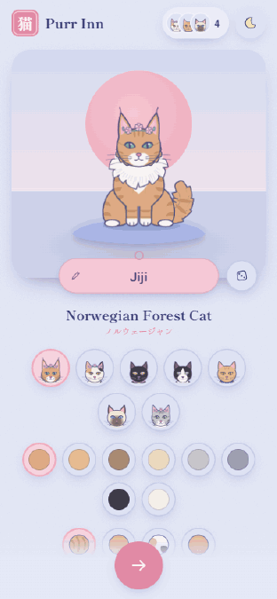

# Purr Inn 猫の宿

A quiet courtyard at a little inn under Mount Fuji. You check in by choosing
and naming a cat, then look after it while it wanders, naps, plays and makes
friends with the cats who live at the inn, all drawn as a soft, pastel
ukiyo-e woodblock print.

**[▶ Play in your browser](https://drgnfly5353.github.io/purr-inn/)** · best on a phone, works on desktop too · [Design report (PDF)](docs/design-report.pdf)



Nobody steers the cats. You feed, brush, pet and play with yours, and the
courtyard carries on around it, the way passengers on a flight share a space
without having to talk. It is mobile-first, icon-first and language-light: the
only words on screen are cats' names.

## How to play

- **Check in:** pick one of seven breeds (the Norwegian Forest Cat first), then its coat, pattern, white markings, fur, eyes and accessory, all from pictures. Its name goes on the pink nameplate under it; the dice suggests one.
- **Look after your cat:** the five buttons at the bottom feed, play, brush, tuck in for a nap and pet. The icon you tap floats to your cat and it reacts. Tap the garden to toss a yarn ball.
- **See how it's doing:** tap its face at the bottom left for four gauges and a mood.
- **Say hello:** tap any other cat to pet it or give it a treat.
- **Who's here:** the faces at the top list every cat at the inn; the scroll is a courtyard diary of small moments ("Mochi ♥ Yuzu").
- **Day and night:** follows your clock until you tap the sun or moon. By night the same courtyard is lit by lanterns, with the moon, stars, fireflies and the odd shooting star.
- **Check out:** the door at the bottom of "who's here" takes you back to choose a new cat.

The resident cats, Mochi, Yuzu, Tofu, Hachi and Kuro (who keeps checking in
and out), live at the inn so the courtyard always feels alive.

## Run it yourself

You need [Node.js](https://nodejs.org) 20 or newer.

```bash
npm install
npm run dev            # http://localhost:5173
npm run dev -- --host  # also open it on a phone on the same Wi-Fi (use the "Network" URL)
npm run build          # production build in dist/
```

Every push to `main` builds the game and publishes it to GitHub Pages
(`.github/workflows/deploy.yml`).

### Handy URLs

| Add to the address | What it does |
| --- | --- |
| `?demo` | Skip the picker and arrive with a Norwegian Forest Cat |
| `?reset` | Forget your cat and start again at the picker |
| `?residents=0` | An empty courtyard: just you and your cat |
| `?gallery` | Design sheet of every breed in every pose |

## How it's made

- **Hand-built SVG cats:** three poses (sit, walk, sleep) with CSS-animated parts, procedural fur for long-haired breeds and brush-stroke tabby markings. No image files. See `src/components/cat/`.
- **A measured picture:** the inn, plaque, lanterns, plants and stepping stones sit around one centre line, with the sun or moon resting on Fuji's peak, so the scene feels balanced without looking mirrored. See `src/components/scene/Backdrop.jsx`.
- **A simulated courtyard:** time is split into 12-second slots, and in each slot every cat gets a plan (wander, groom, nap, watch the koi, meet a friend...) from seeded randomness. Positions are pure functions of the clock; care actions briefly override a cat's plan. See `src/game/sim.js`.
- **Smooth on phones:** the render loop writes transforms straight to the DOM (React never re-renders mid-animation), each cat is its own compositor layer, and only the visible pose animates.
- Built with React 19 and Vite. No backend: your cat is kept in the browser tab, and the last cat you made is remembered for next time.

```
src/
  App.jsx                    choose a cat → courtyard, URL switches
  components/CatPicker.jsx   check-in: choose, customise and name a cat
  components/hotel/          courtyard screen: top bar, dock, popovers, sheets, diary
  components/scene/          courtyard artwork (Backdrop), render loop (HotelScene), effects
  components/cat/            the cat illustrations and animation rig
  components/ui/             icons and small shared pieces (brand, faces, day/night)
  components/StatBars.jsx    the four care gauges
  game/sim.js                the courtyard simulation
  game/care.js               how needs drift and what each care action does
  game/residents.js          the resident cats
  hooks/useHotel.js          who's here, events, actions and the diary
  lib/                       theme, session storage, colours
```

## Background

Purr Inn started as a team project at a hackathon, where the challenge was a
game for hotel guests to share during their stay. This repo is my designer's
cut of that demo: a polished single-player version that runs entirely in the
browser. A shared courtyard across guests' phones may come back later.

The [design report](docs/design-report.pdf) written for the judges covers the
concept, the rounds of design direction, the visual language, colour, day and
night, and each screen. It describes the multiplayer hackathon version.

### Hackathon team

- Ella Wallace ([@ellahopewallace](https://github.com/ellahopewallace))
- Shahd Al Harthy ([@shahdalharthy](https://github.com/shahdalharthy))
- Noor Al Ghammari
- [@drgnfly5353](https://github.com/drgnfly5353): design

The team's hackathon repo: [ellahopewallace/GutsHackathon](https://github.com/ellahopewallace/GutsHackathon)
